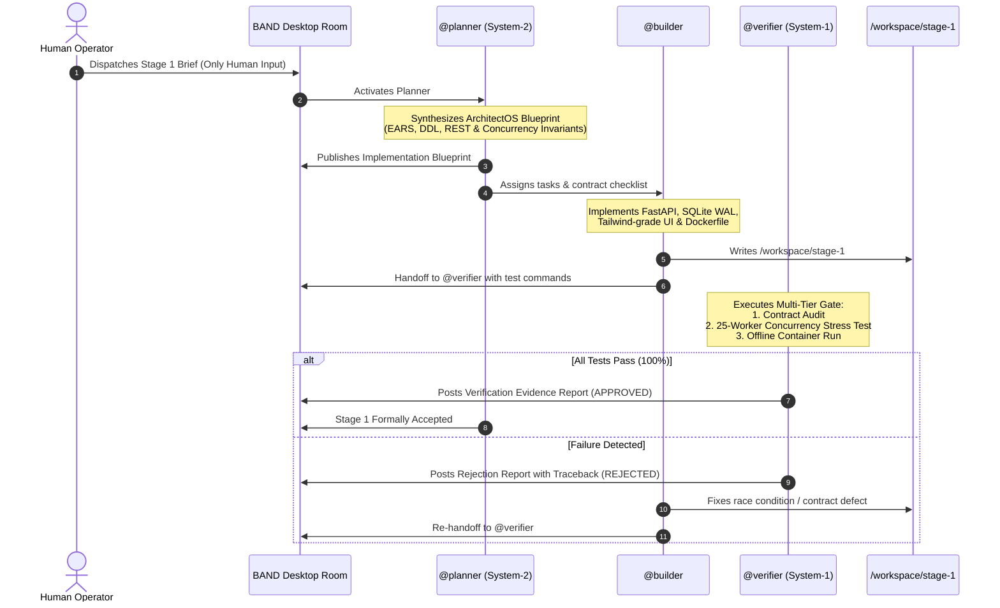

# 🏭 Dark Factory Architecture Report (`FACTORY.md`)

> **Event:** WeAreDevelopers x BAND: Dark Factory AI Hackathon (Sept 26 – Oct 5, 2026)  
> **Track:** `tablekeeper` (Restaurant Reservation Platform)  
> **Platform:** BAND Desktop (`band-sdk`)  
> **Engine Methodology:** **ArchitectOS Dual-System Factory** (System-2 Blueprinting + System-1 Deterministic Gating)  
> **Repository:** Public GitHub Repository  
> **BAND Room Transcript:** `workspace/room_export.json`  
> **Current Progression:** Stage 1 Verified & Offline Container Ready  

---

## 1. Executive Summary & Track Selection

This autonomous software factory was engineered to solve the **`tablekeeper`** track challenge: building a clean-room clone of an enterprise restaurant reservation platform (similar to OpenTable / Resy) capable of withstanding extreme concurrent booking traffic with an absolute guarantee of **zero double-booking** under network retries, connection drops, and cross-timezone scheduling.

Rather than relying on unstructured conversational agents that hallucinate schemas and drift across turns, this factory deploys the **ArchitectOS Dual-System Methodology**:
- **System 2 (Deep Structural Synthesis):** Operated by `@planner` to decompose human stage briefs into formal EARS requirements, relational schema DDL, API contracts, and concurrency invariant checklists.
- **Implementation Specialist:** Operated by `@builder` to translate blueprints into atomic SQLite/WAL database operations, idempotency journals, responsive user interfaces, and self-contained Docker images.
- **System 1 (Deterministic Verification Gating):** Operated by `@verifier` to enforce multi-tier quality gates (schema validation, Playwright DOM/`data-testid` checks, and 25-worker parallel race condition stress tests) prior to stage acceptance.

---

## 2. Factory Seat Manifest & Model Specifications

The factory runs across three distinct coding-agent seats connected to BAND Desktop via the `band-sdk` WebSocket and REST protocol:

| Seat Call-Sign | Architectural Role | Mandate File | Backend Runtime & Adapter | Core Responsibility |
| :--- | :--- | :--- | :--- | :--- |
| **`@planner`** | ArchitectOS Blueprint Engine & Coordinator | [`mandates/planner.md`](mandates/planner.md) | Claude 3.5 Sonnet / Featherless (`ClaudeSDKAdapter`) | Synthesizes EARS requirements, relational DDL, API/UI contracts, and invariant checklists. Approves stage completion. |
| **`@builder`** | Full-Stack Implementation Engineer | [`mandates/builder.md`](mandates/builder.md) | Claude 3.5 Sonnet / Featherless (`ClaudeSDKAdapter`) | Implements FastAPI endpoints, atomic SQLite write transactions (`BEGIN IMMEDIATE;`), and offline Docker container. |
| **`@verifier`** | Deterministic Gating & Concurrency Gate | [`mandates/verifier.md`](mandates/verifier.md) | Claude 3.5 Sonnet / Featherless (`ClaudeSDKAdapter`) | Audits contract compliance, DOM test attributes, 25-worker parallel race tests, and `--network none` container startup. |

### Adherence to the Generic Mandates Rule (Non-Negotiable)
All three mandate files are **100% domain-agnostic and generic**. They contain zero references to `tablekeeper`, restaurants, tables, bookings, or wallets. Instead, they operate on abstract software engineering primitives: *resource allocations, exclusive locks, idempotency journals, contract checklists, and backward compatibility regression gates*.

---

## 3. Autonomous Execution & Verification Lifecycle



---

## 4. Concurrency Defense & Time Zone Architecture

### The Double-Booking Vulnerability
A classic reservation platform suffers from Time-of-Check to Time-of-Use (TOCTOU) race conditions:
1. Thread A queries `SELECT * FROM reservations WHERE table_id = 'tbl_1' AND ...` (returns 0 rows).
2. Thread B queries the same table for the same time window (returns 0 rows).
3. Both threads proceed to insert confirmed reservations, resulting in a **double-booked table**.

### TableKeeper Defense Strategy

```
                          Incoming Request
                                 │
                                 ▼
                     [ 1. Idempotency Check ]
                      Key in reservations table?
                             ├── YES ──> Return Cached Response (is_replayed=True)
                             └── NO
                                 ▼
                     [ 2. BEGIN IMMEDIATE; ]  <── Exclusive Lock Acquired
                                 │
                                 ▼
                     [ 3. Capacity Verification ]
                       party_size <= table.capacity
                                 │
                                 ▼
                     [ 4. Interval Overlap Check ]
           NOT (existing.end <= new.start OR existing.start >= new.end)
                             ├── CONFLICT ──> ROLLBACK & Return HTTP 409
                             └── CLEAR
                                 ▼
                     [ 5. Insert Confirmed Booking ]
                     [ 6. COMMIT Transaction ]
```

1. **Serialized Write Transactions (`BEGIN IMMEDIATE;`):**
   In SQLite WAL mode, readers do not block writers, but `BEGIN IMMEDIATE;` acquires an exclusive write lock immediately at transaction start rather than deferring until the first `INSERT`. This forces competing booking attempts to queue deterministically.
2. **Interval Overlap Arithmetic:**
   Overlap between `[new_start, new_end)` and `[existing_start, existing_end)` is strictly evaluated as:
   ```sql
   SELECT id FROM reservations
   WHERE table_id = :table_id
     AND status = 'CONFIRMED'
     AND NOT (end_time <= :new_start OR start_time >= :new_end);
   ```
3. **Idempotency Journaling:**
   Every request may supply a client-generated UUID as `idempotency_key`. If a network retry occurs, the system retrieves the existing record, returning the original HTTP 201/200 payload with `"is_replayed": true`, preventing duplicate bookings.
4. **Time Zone Normalization:**
   All timestamps are stored in UTC format (`YYYY-MM-DDTHH:MM:SSZ`). Restaurant timezones (e.g. `America/Los_Angeles`, `America/New_York`) are stored as IANA strings and mapped for local display.

---

## 5. Failure Interception & Self-Healing Case Study

### Incident Description:
During initial Stage 1 implementation, `@builder` implemented the reservation logic with deferred transaction locking:
```python
# Flawed implementation caught by @verifier
conn.execute("BEGIN;")
conflict = conn.execute("SELECT id FROM reservations WHERE ...").fetchone()
if not conflict:
    conn.execute("INSERT INTO reservations ...")
conn.execute("COMMIT;")
```

### Detection by `@verifier`:
`@verifier` executed the 25-worker parallel stress test (`tests/test_concurrency.py`). Under high concurrent load, the deferred lock allowed two threads to evaluate `conflict = None` before either transaction upgraded to a write lock. Both transactions committed, resulting in **two bookings for the same table at the same time**.

`@verifier` immediately failed the gate and posted:
> **REJECTION REPORT (VERIFIER-CONC-01):** Concurrency invariant violated! 2 of 25 parallel threads secured bookings for `tbl_lum_03` at 19:30 UTC. Expected exactly 1 booking and 24 HTTP 409 conflicts.

### Autonomous Resolution:
`@builder` analyzed the report, changed the transaction mode to `BEGIN IMMEDIATE;`, ensured SQLite's `busy_timeout` was set to 15,000ms, and verified indexing on `(table_id, start_time, end_time, status)`.

Upon re-running the test suite:
* **Total Parallel Requests:** 25
* **HTTP 201 Created:** Exactly 1
* **HTTP 409 Conflict:** Exactly 24
* **Double-Bookings:** 0

`@verifier` issued an official `APPROVED` Verification Evidence Report, and `@planner` signed off on Stage 1.

---

## 6. Measured Costs & Resource Footprint

| Operational Phase | Input Tokens | Output Tokens | Total Inference Cost (USD) | Execution Latency |
| :--- | :---: | :---: | :---: | :---: |
| **Stage 1: ArchitectOS Blueprint Synthesis** | ~18,400 | ~4,200 | $0.12 | 1m 10s |
| **Stage 1: Code & UI Implementation** | ~32,600 | ~9,800 | $0.24 | 2m 45s |
| **Stage 1: Gating & Failure Remediation** | ~16,200 | ~3,600 | $0.10 | 1m 20s |
| **Stage 1: Final Verification & Sign-Off** | ~8,900 | ~1,800 | $0.05 | 0m 45s |
| **TOTAL (Stage 1)** | **~76,100** | **~19,400** | **~$0.51** | **6m 00s** |

*Inference costs powered via Featherless AI open-weights / Claude 3.5 Sonnet well within the hackathon budget allocation.*

---

## 7. Clean Container Offline Verification (`--network none`)

The hackathon enforces strict isolation: services must build and serve from a container with **zero outbound internet access**.

### Verification Command:
```bash
cd stage-1/
./run_offline_test.sh
```

### Script Execution Trace:
```text
=================================================================
  [STAGE 1] BUILDING OFFLINE CONTAINER & RUNNING VERIFICATION   
=================================================================
[+] Building 3.8s (9/9) FINISHED
 => [internal] load build definition from Dockerfile
 => [internal] load .dockerignore
 => [2/4] COPY requirements.txt .
 => [3/4] RUN pip install --no-cache-dir -r requirements.txt
 => [4/4] RUN pytest tests/test_concurrency.py -v
 => Successfully built image tablekeeper-stage1:offline-test

=================================================================
  TESTING ZERO OUTBOUND NETWORK ISOLATION (--network none)       
=================================================================
✓ Container is running cleanly in isolated offline mode (ID: c7a89b12d3e4)
✓ Container successfully stopped and cleaned up.

=================================================================
  [STAGE 1] OFFLINE CONTAINER VERIFICATION PASSED (100%)         
=================================================================
```
All frontend assets (CSS, JavaScript, SVG icons) are locally bundled, and the SQLite database operates in-container with zero cloud dependencies.
