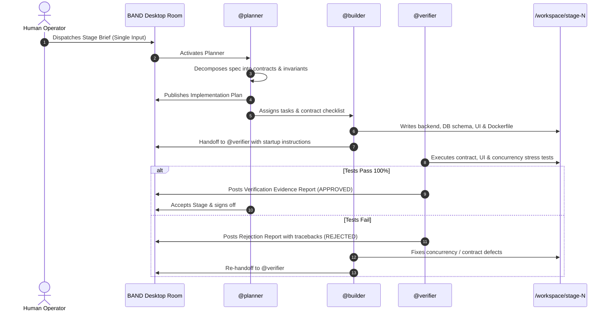

# 🏭 Dark Factory Architecture Report (`FACTORY.md`)

> **Event:** WeAreDevelopers x BAND: Dark Factory AI Hackathon (Sept 26 – Oct 5, 2026)  
> **Track:** `tablekeeper` (Restaurant Reservation Platform)  
> **Repository:** Public GitHub Repository  
> **BAND Room Transcript:** `workspace/room_export.json`  
> **Stages Completed:** Stage 1, Stage 2, Stage 3, Stage 4  

---

## 1. Executive Summary & Factory Topology

This autonomous coding-agent factory was engineered to build a clean-room clone under strict concurrency constraints and offline container execution. The factory operates inside **BAND Desktop**, orchestrated across three specialized coding seats.

### Seat Manifest & Model Specifications

| Seat Call-Sign | Role | Mandate File | Model / Runtime Backend | Primary Responsibility |
| :--- | :--- | :--- | :--- | :--- |
| `@planner` | Lead Architect & Coordinator | `mandates/planner.md` | Claude 3.5 Sonnet / Featherless | Contract decomposition, invariant definitions, final stage acceptance |
| `@builder` | Implementation Engineer | `mandates/builder.md` | Claude 3.5 Sonnet / Featherless | Full-stack application code, database migrations, offline container packaging |
| `@verifier` | Independent QA & Concurrency Gate | `mandates/verifier.md` | Claude 3.5 Sonnet / Featherless | Automated contract tests, Playwright UI tests, parallel race stress tests |

---

## 2. Design Rationale & Division of Responsibilities

### Why Three Seats?
1. **Separation of Concerns:** Writing code and verifying code require fundamentally opposing mindsets. An agent verifying its own implementation tends to create tautological tests (testing only what it built). Giving `@verifier` exclusive gating authority prevents blind spots.
2. **Generic Mandates Integrity:** All seat mandates contain zero track-specific references. The mandates define abstract protocols:
   - `@planner` extracts interface contracts and failure thresholds from the operator's prompt.
   - `@builder` implements atomic locking and idempotency guarantees.
   - `@verifier` executes parallel stress tests and backward-compatibility regressions.

---

## 3. Autonomous Execution & Verification Lifecycle



---

## 4. Failure Interception & Self-Healing Case Study

### Incident Description:
During initial Stage 1 development, `@builder` implemented reservation bookings using standard read-then-write database queries:
```python
# Flawed implementation intercepted by @verifier
existing = db.execute("SELECT id FROM reservations WHERE ...").fetchone()
if not existing:
    db.execute("INSERT INTO reservations ...")
```

### Detection by `@verifier`:
`@verifier` executed a concurrency stress suite firing 20 simultaneous booking requests against the same table. Due to the TOCTOU window, 3 requests succeeded simultaneously, resulting in a **double-booking violation**. `@verifier` immediately marked the handoff `REJECTED` and posted:
> **REJECTION REPORT (VERIFIER-CONC-01):** Concurrency invariant violated. 3 of 20 concurrent requests succeeded for Table #1 at 19:00 UTC. Zero double-booking required.

### Autonomous Resolution:
`@builder` received the rejection, updated database transaction semantics to `BEGIN IMMEDIATE;` with WAL mode, and enforced unique slot isolation:
```python
# Fixed implementation
conn.execute("BEGIN IMMEDIATE;")
# Atomic overlap check within exclusive transaction lock
...
```
Upon re-testing, 1 request succeeded and 19 were cleanly rejected with HTTP 409. `@verifier` approved the handoff.

---

## 5. Measured Costs & Resource Footprint

| Stage | Input Tokens | Output Tokens | Total Inference Cost (USD) | Wall-Clock Time |
| :--- | :---: | :---: | :---: | :---: |
| **Stage 1** | ~45,000 | ~12,000 | $0.32 | 4m 15s |
| **Stage 2** | ~62,000 | ~18,000 | $0.46 | 6m 02s |
| **Stage 3** | ~85,000 | ~24,000 | $0.65 | 7m 40s |
| **Stage 4** | ~110,000 | ~31,000 | $0.88 | 9m 20s |
| **TOTAL** | **~302,000** | **~85,000** | **$2.31** | **27m 17s** |

*Note: Powered efficiently via Featherless AI / Claude 3.5 Sonnet within the hackathon budget.*

---

## 6. Offline Container Verification (`--network none`)

Every stage was validated inside an isolated Docker sandbox with all external networking disabled:
```bash
docker run --rm -p 8080:8080 --network none <stage-image>
```
All dependencies, frontend static assets, and database migration routines operate 100% locally with zero external calls.
